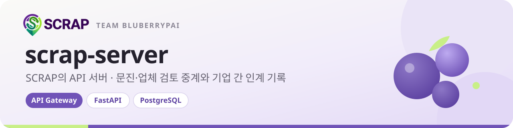

<div align="center">



<br>


[빠른 시작](#빠른-시작) · [API](#api) · [데이터 모델](#데이터-모델) · [실행 상세](backend/README.md) · [팀 규칙](docs/team-conventions.md)

</div>

중소 제조 사업장의 폐기물을 **분류부터 처리업체 인계까지** 이어 주는 자원순환 네비게이터 **SCRAP**의 API 서버.

화면(scrap-web)이 부르는 유일한 백엔드임. 회원·기업 정보와 기업 간 인계 기록을 PostgreSQL에 저장하고, 문진은 scrap-diagnosis로, 업체 AI 검토는 scrap-route로 중계함. 서버 자체는 LLM을 부르지 않음.

> [!NOTE]
> 문진의 분류 판정과 업체의 반입 승인은 다름. AI 검토는 공정 관련성과 공개 근거를 확인할 뿐이고, 실제 반입은 수신 기업이 대화 후 수락함.

## 서비스 흐름

| 단계 | 내용 | 서버가 하는 일 |
| --- | --- | --- |
| 온보딩 | 로그인, 기업·사업장 정보, 지도 위치 | 소셜 로그인·JWT 쿠키, 기업 정보·변경 이력, 주소 검색 |
| 문진 | 질문 응답 → 분류번호 판정·확정 | scrap-diagnosis `/internal/v1` 중계, 탈퇴 시 엔진 데이터 삭제 |
| 법정 서식 | 제6호·제12호·제5호 작성본 | 확정 판정 + 기업 정보로 HWPX·PDF 생성 (저장·제출하지 않음) |
| 처리 경로 | 다음 공정·업체 후보 | 공정·사업장 참조(PostgreSQL)에서 후보 계산, 도로거리순 5곳 선정 |
| 업체 검토 | 사진·상태·공개 근거 AI 검토 | DB 작업 큐로 scrap-route 호출, 공개 근거 결과 7일 캐시 |
| 인계 | 인수 요청 → 수락 → QR 입고 → 산출물 → 다음 업체/완료 | 기업 간 물량·요청·조건·사진·산출물 기록 |

## 조직 레포 구성

| 레포 | 역할 |
| --- | --- |
| **scrap-server (이 레포)** | API, 인증·회원, 기업 정보, 공정·사업장 참조, 업체 후보, 인계 기록, 법정 서식 |
| scrap-diagnosis | 문진·분류 판정 엔진 |
| scrap-route | 업체 후보별 AI 검토(사진 관찰·공개 근거·물량 대조), 공개 웹 조사 |
| scrap-web | 화면 |
| scrap-infra | 전체 통합 실행(compose), Azure 리소스 정의 |

```
scrap-web ──/api──▶ scrap-server ──▶ scrap-diagnosis  (/internal/v1, ENGINE_SERVICE_TOKEN)
                        │       └──▶ scrap-route      (/treatment/*, SCRAP_INTAKE_SERVICE_TOKEN)
                        └──▶ PostgreSQL
```

## 빠른 시작

server만 띄우는 방법임. 다섯 서비스를 함께 띄우려면 scrap-infra의 통합 compose를 사용함. 자세한 내용과 문제 해결은 [backend/README.md](backend/README.md).

**A. Docker (팀 표준)** (Docker Desktop만 필요, DB는 PostgreSQL)

```bash
cp .env.example backend/.env
docker compose up -d --build
```

**B. 로컬 (보조)** (uv만 필요, DB는 SQLite)

```bash
cd backend
cp ../.env.example .env
uv sync
uv run alembic upgrade head
uv run uvicorn app.main:app --reload
```

실행 후 http://localhost:8000/docs (Swagger) 에서 `POST /api/v1/auth/dev-login`을 실행하면 OAuth 키 없이 로그인된 상태로 API를 시험할 수 있음 (`APP_ENV=local`에서만).

## 기술스택

| 영역 | 선택 |
| --- | --- |
| 언어 / 프레임워크 | Python 3.12 / FastAPI |
| DB | PostgreSQL 17 (로컬 개발은 SQLite도 가능) |
| ORM / 마이그레이션 | SQLAlchemy 2.0 (async) / Alembic |
| 인증 | Google·Microsoft 소셜 로그인 (Authlib), JWT httpOnly 쿠키 |
| 외부 연동 | 카카오모빌리티 길찾기(도로거리·경로), Photon(주소 검색), OSRM(키 없는 시연용 도로거리, 기본 꺼짐) |
| 패키지 / 품질 | uv / ruff, pytest |
| 배포 | Azure App Service(컨테이너, Korea Central). main 병합 → ACR `:main` push → ACR 웹훅으로 재시작 ([.github/workflows/deploy-azure.yml](.github/workflows/deploy-azure.yml)) |

선정 이유: [docs/adr/0001-backend-stack.md](docs/adr/0001-backend-stack.md). Azure 구성: scrap-infra `docs/deploy-azure.md`

## 구조

```
scrap-server/
├─ AGENTS.md / CLAUDE.md     AI 코딩 에이전트 진입점
├─ .agents/ · .claude/       에이전트 역할·스킬 (원본은 .agents, .claude는 scripts/sync_agents.py 생성물)
├─ .github/                  CI, Azure 배포, 이슈·PR 템플릿
├─ docs/                     제품 정의, spec, ADR, 검증 기록, 운영 절차
├─ scripts/                  에이전트 문서 동기화, 법정 서식 칸 위치 생성, 검증·조사 스크립트
├─ backend/
│  ├─ app/
│  │  ├─ core/               설정, JWT, 공통 오류 형식
│  │  ├─ db/                 DB 엔진·세션, 모델 모음
│  │  ├─ api/v1/             /api/v1 라우터 묶음
│  │  └─ domains/
│  │     ├─ auth · users · companies   로그인, 회원·탈퇴, 기업 정보·주소 검색
│  │     ├─ diagnosis                  문진 엔진 중계, 확정 판정 → 처리 경로 연결
│  │     ├─ legal_forms                법정 서식 HWPX·PDF 작성본
│  │     ├─ treatment                  공정·사업장 참조, 후보, 도로거리, 5곳 검토, 공개 근거 캐시
│  │     ├─ transport                  기업 간 인계(workflow), 반입조건, 검토 작업 큐, 도로 경로
│  │     └─ facilities · wastes        사업장·폐기물 카드 모델
│  ├─ alembic/               마이그레이션
│  └─ tests/
└─ docker-compose.yml        api + PostgreSQL (호스트 포트 5433), 선택 프로필 engine·storage
```

폴더별 책임과 의존 규칙: [docs/folder-architecture.md](docs/folder-architecture.md)

## API

전체 명세는 Swagger(`/docs`). 오류는 모든 API에서 `{"code", "message", "details"}` 형식 ([docs/specs/error-response.md](docs/specs/error-response.md)).

### 인증·회원·기업

| 메서드 | 경로 | 설명 |
| --- | --- | --- |
| GET | /api/v1/auth/{google\|microsoft}/login | 소셜 로그인 시작 |
| GET | /api/v1/auth/{provider}/callback | 로그인 완료, 쿠키 발급 |
| POST | /api/v1/auth/refresh | access·refresh 토큰 재발급 (refresh 회전) |
| POST | /api/v1/auth/logout | 로그아웃 (refresh 토큰 폐기) |
| POST | /api/v1/auth/dev-login | 개발용 로그인 (`APP_ENV=local`·`test`에서만 존재) |
| GET | /api/v1/users/me | 현재 사용자 (온보딩 전이면 기업 ID null) |
| POST | /api/v1/users/me/withdraw | 회원 탈퇴 (유예 기간 뒤 삭제) |
| POST | /api/v1/companies | 기업·사업장 등록 (온보딩) |
| GET · PATCH | /api/v1/companies/me | 내 기업 조회·수정 (`profile_version`으로 충돌 감지, 좌표 `site_latitude`·`site_longitude`) |
| GET | /api/v1/companies/me/history | 기업 정보 변경 이력 |
| POST | /api/v1/companies/location-search | 주소·장소 검색 (기업 등록 전에도 사용) |

### 문진 (scrap-diagnosis 중계)

로그인한 기업의 요청을 엔진 `/internal/v1`로 넘기고 응답 본문은 그대로 돌려줌. spec: [docs/specs/diagnosis-engine-integration.md](docs/specs/diagnosis-engine-integration.md)

| 메서드 | 경로 | 설명 |
| --- | --- | --- |
| POST · GET | /api/v1/diagnosis/cases | 문진 건 만들기 + 첫 질문 / 내 기업의 건 목록 |
| GET | /api/v1/diagnosis/cases/{id} | 건 상세 (판정, 대화, 서류, 인계 객체) |
| POST | /api/v1/diagnosis/cases/{id}/messages | 문진 답변 (말 또는 버튼) |
| POST | /api/v1/diagnosis/cases/{id}/documents | 서류 업로드 (읽은 값은 검수 대기) |
| POST | …/documents/{doc}/versions · values/apply · revoke | 서류 교체 · 검수한 값 반영 · 효력 해제 |
| POST | /api/v1/diagnosis/cases/{id}/confirm · reopen · rebase | 판정 확정(인계 객체) · 다시 열기 · 바뀐 규칙으로 재평가 |
| GET | /api/v1/diagnosis/cases/{id}/trace | 판정 근거 추적 |
| GET | /api/v1/diagnosis/catalog/facts | 질문 항목·선택지 목록 |
| POST | /api/v1/diagnosis/cases/{id}/treatment/next-step | 확정 판정의 다음 공정·업체 후보 |
| POST | /api/v1/diagnosis/cases/{id}/treatment/intake-reviews | 확정 판정 기준 업체 AI 검토 |
| POST | /api/v1/diagnosis/cases/{id}/legal-forms/{form6\|form12\|form5}/preview | 서식 칸별 값 미리보기·경고 |
| POST | /api/v1/diagnosis/cases/{id}/legal-forms/{form6\|form12\|form5}?format=hwpx\|pdf | 서식 작성본 파일 ([spec](docs/specs/legal-forms.md)) |

### 기업 간 인계 (`/api/v1/workflow`)

물량(lot)을 등록하고 업체를 검토한 뒤 인수 요청(offer)으로 넘기는 흐름. 참여 기업만 조회·수정할 수 있음.

| 묶음 | 경로 | 설명 |
| --- | --- | --- |
| 물량 | `POST/GET /lots`, `GET /lots/{id}`, `POST/DELETE /lots/{id}/photos`, `GET /photos/{key}` | 물량 등록·조회, 사진 |
| 업체 검토 | `POST /lots/{id}/review-jobs` (202), `GET /lots/{id}`의 `review_progress` | 도로거리순 5곳 검토 작업 시작·진행 조회 ([spec](docs/specs/progressive-candidate-review.md)) |
| 후보 보조 | `/lots/{id}/candidates`(동기, 호환용), `/directory`, `/directory-inquiries`, `/inquiry-packet`, `/intake-answers` | 전국 명부 조회, 미가입 업체용 문의서, 업체별 답변 |
| 사진 불일치 | `POST /lots/{id}/photo-conflict-resolution` | 사진·설명이 다를 때 사용자 확인 또는 설명 수정 ([spec](docs/specs/photo-conflict-resolution.md)) |
| 인수 요청 | `POST /lots/{id}/offers`, `GET /offers/{id}`, `/offers/{id}/messages · decision · conditions · condition-responses` | 요청, 문의·답변, 수락·거절·조건부 수락, 조건별 자료 제출·확인 |
| 운송·입고 | `/offers/{id}/dispatch · qr · receive`, `GET /lots/{id}/road-route` | 출발 기록, QR 발급, 입고 확인, 인계 도로 경로 |
| 산출물 | `/lots/{id}/output · output-correction · output-action · finish` | 실제 산출물 기록, 정정, 완료·추가 가공·보관, 완료 ([spec](docs/specs/output-disposition-card-sync.md)) |
| 반입조건 | `GET/POST /supplier-policies` | 업체 계정이 자기 사업장의 반입조건 등록 ([spec](docs/specs/supplier-intake-policy.md)) |

`/api/v1/transport/*`는 현장 인계 기록(공유 건·수신함·이벤트)을 다룸 ([spec](docs/specs/transport-handoffs.md)).

### 처리 경로 직접 조회 (`/api/treatment`)

| 메서드 | 경로 | 설명 |
| --- | --- | --- |
| POST | /api/treatment/next-step | 재질·형태 기준 다음 공정 |
| POST | /api/treatment/facility-candidates | 공정별 처리업체 후보 |
| POST | /api/treatment/intake-review(s) | 업체 반입 근거 AI 검토 (scrap-route) |
| POST | /api/treatment/facility-web-search | 공정별 공개 웹 조사 (scrap-route). 결과는 단서이며 자동으로 후보가 되지 않음 |

`/api/classification/*`는 이전 문진 엔진(`CLASSIFICATION_BASE_URL`)용 호환 경로이며 현재 웹은 쓰지 않음.

## 데이터 모델

| 테이블 | 내용 |
| --- | --- |
| users, refresh_tokens | 로그인 정보·탈퇴 정보, 갱신 토큰(회전·폐기) |
| companies, company_profile_history | 기업·사업장 정보 (회원당 1곳, 좌표·배출 정보·버전), 변경 이력 |
| facilities, facility_waste_codes, facility_r_types | 처리 사업장과 허가 분류번호·R유형 |
| facility_import_rows | 전국폐기물처리업소표준데이터 원본 행 |
| treatment_snapshots | 공정 참조 카탈로그, 공개 근거 검토 캐시(`public-intake-cache-v1`) |
| workflow_lots, workflow_offers, workflow_photos | 물량·검토·진행 이력, 인수 요청·조건·QR, 물량 사진 |
| workflow_facility_accounts | 서비스 기업 계정 ↔ 공개 사업장 연결 (시험용은 synthetic으로 구분) |
| supplier_intake_policies | 업체가 등록한 반입조건 (버전) |
| transport_handoffs, transport_shared_cases | 현장 인계 기록·공유 건 |
| wastes, route_steps, qr_field_checks, waste_completion_snapshots | 폐기물 카드·인계 단계·입고 확인·완료 시점 기록 |

문진 판정 원본은 scrap-diagnosis가 관리하고, 서버는 확정 인계 객체를 물량에 보존함.

## 문서

| 문서 | 내용 |
| --- | --- |
| [backend/README.md](backend/README.md) | 실행, 환경변수, 데이터 적재, 문제 해결 |
| [docs/product-plan.md](docs/product-plan.md) | 목적, 사용자, MVP 범위, 판단 원칙 |
| [docs/folder-architecture.md](docs/folder-architecture.md) | 폴더 구조와 책임 |
| [docs/specs/](docs/specs/) | 기능 명세 |
| [docs/adr/](docs/adr/) | 기술 결정 기록 |
| [docs/todolist.md](docs/todolist.md) | 할 일과 진행 상태 |
| [docs/registry-screen/](docs/registry-screen/README.md) | 사업장·공정 근거 조사 기록 |
| `docs/*-2026MMDD.md` | 날짜별 검증 기록 (예: [업체 탐색 기준](docs/company-material-discovery-20261120.md)) |
| [docs/team-conventions.md](docs/team-conventions.md), [docs/git-workflow.md](docs/git-workflow.md) | 팀 공통 규칙, 이 레포의 Git 설정 |
| [docs/runbooks/](docs/runbooks/) | 운영 절차 |

## 기여 방법

팀 공통 규칙 (레포 역할, 브랜치, CI/CD, 배포): [docs/team-conventions.md](docs/team-conventions.md)

1. develop에서 `feat/T-xxx-설명` 형식으로 브랜치 생성
2. 작업 후 develop으로 PR (CI 통과 필수, main은 배포 담당자만 병합)
3. AI 에이전트를 쓰면 [AGENTS.md](AGENTS.md)의 규칙과 작업 종료 루프를 따름
